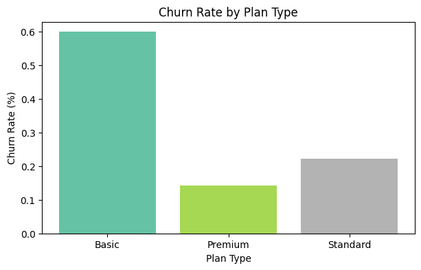
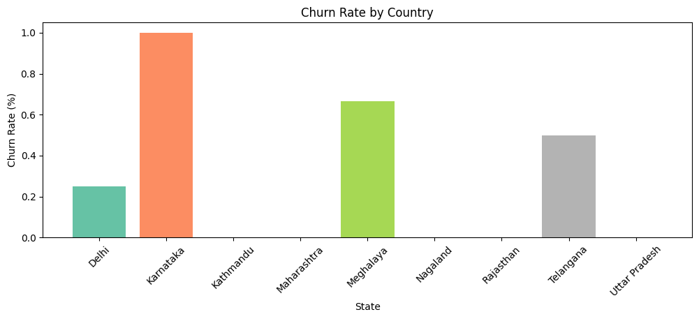
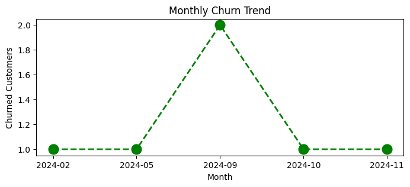
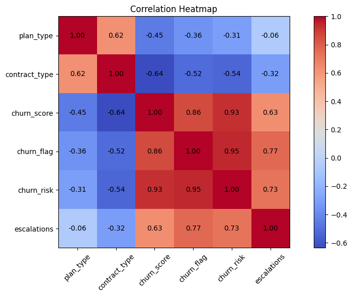

# Customer Churn Analysis (OTT Subscription Data)

A data analytics project that finds **who churned, where the revenue risk is, and which customer groups need attention** for an OTT streaming platform, using Python and a SQLite database.

## Business Problem

In streaming, keeping existing subscribers is cheaper than winning new ones. This project measures churn, finds the customer segments that leave the most, and estimates the revenue affected.

## Dataset

SQLite database `customer_churn.db` with 3 tables linked by `customerid` (21 customers):

| Table | What it holds |
|---|---|
| `db_customer` | name, country, state, gender, date of birth |
| `db_subscription` | start, renewal and cancellation dates, plan type, contract type, subscription source, monthly charges, CLTV, churn score |
| `db_support` | complaint date, escalation (Y/N), CSAT score |

## Tools Used

Python, SQL (SQLite), Pandas, NumPy, Matplotlib, Seaborn, Jupyter Notebook

## Approach

1. **Data extraction:** connected Python to SQLite and loaded each table into a DataFrame
2. **Data cleaning:** renamed columns, dropped empty columns, fixed data types, standardised gender values, filled missing country values using state
3. **Feature engineering:** churn flag, tenure in days, churn risk level (low / med / high from churn score), complaint count per customer
4. **Merging:** joined the three tables on `customerid` and checked row counts to avoid duplicates
5. **KPI analysis:** `groupby`, `agg` and pivot tables
6. **Visualisation:** monthly churn trend, churn by plan and state, correlation heatmap, pairplot, catplot

## Key Results

| KPI | Result |
|---|---|
| Churn rate | 28.57% (6 of 21 customers) |
| Retention rate | 71.43% |
| ARPU (average monthly revenue per user) | 18.85 |
| Revenue at risk (monthly charges of churned customers) | 73.94 (about 18.7% of total monthly charges) |
| Escalation rate | 19.05% of customers |
| Average complaints per customer | 0.43 |
| Correlation: escalation vs churn | 0.77 |

**Churn rate by plan type:** Basic 60.00% | Standard 22.22% | Premium 14.29%


## Charts









## Findings

- **Basic plan customers churn the most** (60%), far above Premium (14.29%).
- **Referral customers churned the most by acquisition source:** 5 of 6 left, compared with 1 of 6 for Paid and 0 of 9 for Organic.
- **Churn peaked in September 2024** (2 customers); every other month with churn had 1.
- **Karnataka and Meghalaya** have the most churned customers (2 each), although each state group is very small.
- **Escalations and churn move together** (correlation 0.77), so unresolved support issues may be an early warning sign.

## Recommendations

- Investigate why Basic-plan and referral customers leave (pricing, offers, onboarding).
- Prioritise customers with a high churn score and high CLTV for retention outreach.
- Resolve escalated support cases quickly.

## Limitations

- The dataset is very small (21 customers), so percentages and correlations are indicative only.
- Only the latest complaint per customer is kept after removing duplicates.
- Tenure for active customers uses today's date, so it changes each time the notebook runs.

## Project Structure

```
customer-churn-analysis/
├── churn_analysis.ipynb     # full analysis
├── customer_churn.db        # SQLite database
├── images/                  # chart images used in this README
└── README.md
```

## How to Run

1. Install the libraries: `pip install numpy pandas matplotlib seaborn notebook`
2. Keep `customer_churn.db` in the same folder as the notebook.
3. Open `churn_analysis.ipynb` in Jupyter and choose *Kernel → Restart & Run All*.

## 👨‍💻 Author
Rajnarayan Singh Rajput

Aspiring Data Analyst | SQL Enthusiast | Data-Driven Problem Solver
